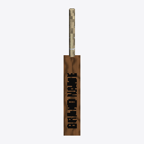

# Sketch2Shape AI: sketch, photo or words → a textured, exportable 3D prototype

<p align="center"></p>

**In 30 seconds:** draw a rough sketch (or upload a photo, or just describe it). Sketch2Shape builds a real, textured 3D model that keeps your outline, **holes and thin parts** (handle loops, racket strings, wheel spokes). It scores how faithful the model is to your drawing, and lets you refine it, recolour any part, bake in crisp text, and export `.glb` / `.obj` / `.stl` or view it in AR. It runs on an ordinary CPU laptop.

**Judge quick path (about 2 minutes):**
1. `./run.sh` (macOS/Linux) or `.\run.ps1` (Windows). It sets itself up on first run, then open http://127.0.0.1:7860 , the google collab link https://1179176696b493b1be.gradio.live/
2. **Upload** `samples/hard_cases/racket.png` with the prompt `a badminton racket with strings`, then click **Create 3D Shape**.
3. Expect an open racket head with clean strings. **📐 Accuracy report** shows IoU, thin-part recall and holes found vs expected.
4. Try **🎨 Colours & materials** (recolour parts), **🔤 Text & logo** (bake text), **📱 AR** (scan the QR), and **Download (.GLB)**.

> **Keys:** none are required. With no keys, the app uses Sketch-CAD (instant, offline) and local TripoSR, and every hard-case result in §8b was measured that way. A free **Gemini** key adds the AI-CAD planner (better part structure and chat edits); the §8 sample table was measured *with* that key. HF/Replicate tokens only add optional cloud engines.


**TechZephyr 4.0 · IIT Bhubaneswar.** Draw on the canvas, upload a photo, or describe what you need. You get **real 3D geometry** (`.glb`, plus `.obj`+texture and `.stl`) that stays faithful to your sketch. It comes with an interactive preview, a Sketch-Fidelity score, a mesh validation report, crisp baked-in text/logos, a 360° turntable and a phone **AR** view.

> **Objective.** Turn rough 2D intent (a sketch, a reference photo, a sentence, or any mix) into one evolving, exportable 3D asset. Its *structure follows the drawing*, its *style follows the words and photos*, and it works on an ordinary CPU laptop with no paid APIs.

---

## Contents
1. [Features](#1-features) · 2. [Quick start](#2-quick-start) · 3. [Using the app](#3-using-the-app) · 4. [Architecture](#4-architecture) · 5. [REST API & CLI](#5-rest-api--cli) · 6. [Models, APIs & licences](#6-models-apis--licences) · 7. [Hardware & runtimes](#7-hardware--runtimes) · 8. [Benchmark (cached samples)](#8-benchmark-cached-samples) · 9. [Limitations & failure cases](#9-limitations--failure-cases) · 10. [Troubleshooting](#10-troubleshooting) · 11. [Assumptions](#11-assumptions) · 12. [Repo layout](#12-repo-layout)

See also: [DEMO.md](DEMO.md) (3-minute demo script), [docs/REPORT.md](docs/REPORT.md) (design report and earlier measurements) and [LICENSE](LICENSE) (MIT for our code; third-party models keep their own licences).

## 1. Features

| | Feature | What it does |
|---|---|---|
| ⭐ | **Session-based multi-input refinement** | A project is **one evolving asset**. Add inputs in any order (prompt first, then a sketch or a reference photo, then more words). Each input makes a new **version** in the **timeline** (`v1 💬 prompt → v2 📷 photo → v3 ✏️ sketch tweak → v4 🔤 decal`). It has **one-tap revert** (non-destructive) and **side-by-side compare**. **"This input controls"**: *Shape + style*, *Shape only*, or *Style & colour only* (shape locked while you restyle). |
| ⭐ | **Recolour parts after building** | Open **🎨 Colours & materials**: every part of the model is listed by name with its colour swatch ("body", "lid", "spout", "handle", "petal 1…8", with *all petals* shortcuts). Tick **one or several** parts, pick a colour and optionally a new material (wood, marble, gold, glass, leather… 27 options), then **Apply**. Textured parts keep their grain while changing hue; other parts are untouched. Each recolour is a new version (undo or revert), baked decals are re-applied on top, and the AI plan is updated so later AI edits keep the new colours. |
| ⭐ | **Decal / text / logo layer** | Generative models can't spell, so we draw lettering ourselves. Type text (4 fonts, any colour) or upload a logo, choose the side, position, size and rotation; **Live move** re-places it as you drag the sliders. It is **baked into the model's texture**: projected like a stencil, each covered triangle is rasterised in UV space and the decal pixel is written to its texel in a per-mesh atlas (2–4K). Depth-tested so it never shows through; no extra decal meshes. It ships inside the `.glb`/`.obj` and **survives later AI edits** (decals are re-baked onto each new version). |
| ⭐ | **4 candidates + auto-ranking** | For a sketch or photo, 4 candidate images are generated (one batched call on GPU) and ranked by **sketch match 50%** (silhouette IoU + edge chamfer), **3D-readiness 30%** (one connected object, centred, not cropped, clean background, after rembg) and **prompt match 20%** (CLIP; skipped and renormalised with no prompt). Every card shows the total and components, the top one is badged **★ BEST**. You click one, or tick **Auto** to send the best straight to 3D. **Only the chosen image** goes to the expensive image-to-3D step. |
| ⭐ | **Structural accuracy: holes, loops, strings survive** | The input is *analysed* before 3D. Through-holes (handle loops, racket heads, open chair backs, scissor loops), thin structures (wires, single-line handles) and line families (racket strings, basket wires, wheel spokes) are detected and shown as an overlay; **click any region to mark or unmark it as a hole**. Every model is then measured against the sketch: **Accuracy = 0.4·silhouette IoU + 0.3·thin-feature recall + 0.3·hole match**. Below 90% (configurable) it is **carved and extended** to the sketch: voxels projecting onto holes or background are removed, missing parts are extruded at the neighbours' depth, and strings, wires and spokes are **rebuilt as clean cylinders**. If it is still short, the build is **retried with another engine** and the best result is kept. The **Accuracy report** shows IoU, thin recall, expected vs found holes, the refinement history, before/after silhouettes and a raw/refined model toggle. Lost holes or thin parts are always stated, never hidden. |
| ⭐ | **Sketch-Fidelity score + auto-retry** | The finished mesh is rendered from each of its four sides and the best-matching silhouette is compared with the sketch contour (IoU + edge chamfer), so a side-view sketch is not penalised because the model faces another way. This is shown as **Accuracy %** for every version. If a model read from a sketch (Studio or one-shot pipeline) scores below 62%, it is **re-planned automatically** with the score as feedback (max 2 retries); the best attempt is kept and the improvement is logged ("fidelity retry 1: 48% → 71%"). |
| | **AR in one scan** | A QR code opens a Google `<model-viewer>` page on your phone (same Wi-Fi). Tap *View in your room* (Android Scene Viewer / iPhone Quick Look / WebXR). |
| | **AI-CAD: sketch → idealised model** | A vision LLM reads the sketch, names every part (cup, lid, stem, two handles…), measures proportions and rebuilds it as **clean CAD** (mirrored handles, smooth lathe profiles, per-part materials). A floating-part self-check reattaches misplaced parts. |
| | **Sketch-CAD (instant, offline)** | Lathe objects are **revolved** from the drawn profile (hollowed if they are containers, handles as tubes). Flat objects are **extruded** with holes kept, organic ones **inflated**. |
| | **Local AI image-to-3D** | TripoSR on your CPU or GPU, unlimited and with no keys. TRELLIS (cloud) when quota allows. Offline inflation is the last resort that always returns a valid GLB. |
| | **Auto-caption** | No prompt? Local CLIP names the sketch ("a coffee mug") to form a base prompt. |
| | **Real textures** | 27 procedural PBR textures (wood, marble, brushed/cast metal, chrome, ceramic, fabric, leather, granite, glass…) tinted by the prompt colour, UV-mapped per part. |
| | **Prompt understanding** | 148 CSS colours + shades + `#hex`, 26 materials, per-part colours ("red mug with a **black handle**"), shape words (`hexagonal`, `domed`, `ribbed`, `tall`, `slim`, `no handle`…), 33 parametric templates for prompt-only creation. |
| | **Validation & export** | trimesh repair (floaters, degenerate/duplicate faces, normals, holes), unit-box normalisation, `.glb` / `.obj`+mtl+texture zip / `.stl`, then the GLB is **re-opened** to prove it loads. The report covers vertices, faces, watertight, texture present, parts, file size, extents, sketch fidelity and decals. |
| | **Turntable** | 360° GIF of the final model (texture-sampled, decals visible). |
| | **Never stuck** | Provider router with retries, persisted quota cooldowns (a spent quota is skipped until it is likely to reset), GPU OOM fallback (batch → one at a time), and an offline path for every stage. |

## 2. Quick start

**One command.** It sets up on first run (venv, packages, ~2.5 GB of model weights), then starts the app:

```bash
./run.sh            # Linux / macOS / WSL / Git Bash   (or: make setup && make run)
```
```powershell
.\run.ps1           # Windows PowerShell
```
Open **http://127.0.0.1:7860**. Interactive API docs are at **/docs**.

**Manual (non-Docker):**
```bash
git clone https://github.com/pranayharshithsalla/sketch2shape.git && cd sketch2shape
python -m venv .venv
# Windows: .venv\Scripts\activate      macOS/Linux: source .venv/bin/activate
pip install -r requirements.txt          # CUDA GPU: pip install -r requirements-gpu.txt (after a CUDA torch)
python scripts/download_models.py        # TripoSR + CLIP + rembg weights (add --gpu for SD1.5 + ControlNet)
cp .env.example .env                     # optional keys, all OPTIONAL (see §6)
python app.py                            # --offline: no network at all · --share: public gradio link
```

**Docker:**
```bash
docker compose up --build                                  # CPU
docker compose --profile gpu up --build app-gpu            # NVIDIA GPU (NVIDIA Container Toolkit)
# note: the Docker files were written for this release but not build-tested on our (Docker-less) dev laptop
```

**Verify:**
```bash
python -m pytest -q tests          # 44 tests (42 pass; 2 known IoU misses, see §8b): preprocessing, ranking, decals, versions, export, API, hard cases
python scripts/smoke_test.py       # offline end to end: sketch → 4 ranked candidates → .glb → decal → reload
```

No API key is needed for anything above. Keys only add optional cloud engines (§6).

## 3. Using the app

**Studio** (first tab): your design session.
1. Pick a mode in the top bar: **✏️ Draw rough sketch** (grid sketchpad: pen colours, eraser, stroke size, undo, clear), **📷 Upload an image** (sketch photo or reference photo) or **💬 Explain what you need**.
2. Optionally type a prompt (never required with a sketch or photo) and choose **This input controls**: *Shape + style* / *Shape only* / *Style & colour only*.
3. **Create 3D Shape**. The button becomes **Update 3D Shape**: every later input refines the same model as a new version.
   Alternatively, **🎲 Generate 4 candidates**: ranked cards appear. Click one, then **Build 3D from the selected candidate**, or tick **Auto**.
4. Right panel: the 3D preview (drag, or use the ⟲ ⟳ ▲ ▼ ＋ － buttons), **Accuracy / Print ready (basic check: every part watertight) / Parts / Build time**, **Download (.GLB)**, then:
   - **🕘 Version timeline**: select a version, then **↩ Revert** or **⟷ Compare** side by side.
   - **🔤 Text & logo**: text or logo, font, colour, side, position, size, rotation → **Bake onto model**. Tick **Live move** to drag it with the sliders.
   - **📱 AR & turntable**: QR for your phone; render a 360° GIF.
   - **✅ Validation report**, **Other formats** (.obj zip with texture, .stl).

**Advanced: engines & pipeline** (second tab): the stage-by-stage pipeline with every intermediate image, per-stage timings, a manual choice of engine, provider, candidate count and seed, and the full log.

## 4. Architecture

```mermaid
flowchart LR
  subgraph IN[Inputs, any order, one session]
    S[✏️ Sketch canvas] --- U[📷 Upload / photo] --- P[💬 Prompt]
  end
  IN --> PRE[1 Preprocess<br/>white-composite, CLAHE,<br/>Otsu, despeckle, crop 512,<br/>silhouette + scribble map]
  PRE --> AN[1b Input analysis<br/>holes · thin parts · string/spoke families<br/>click-to-toggle]
  AN --> CAP[2 Auto-caption<br/>CLIP, if no prompt]
  CAP --> R{Engine}
  R -->|Gemini key| AICAD[AI-CAD<br/>vision LLM part plan → CAD]
  R -->|lathe / flat| SCAD[Sketch-CAD<br/>revolve / extrude / inflate]
  R -->|candidates| GEN["3 Generate 4 candidates<br/>SD1.5+ControlNet batch on GPU ·<br/>FLUX Kontext · Gemini · local render"]
  GEN --> BG[rembg] --> RANK[4 Rank<br/>sketch 50 · 3D-ready 30 · prompt 20]
  RANK -->|user pick / Auto| I3D[5 Image→3D<br/>TripoSR · TRELLIS · inflation]
  AICAD --> FID
  SCAD --> FID
  I3D --> FID["6 Fidelity check<br/>render silhouette vs sketch<br/>auto-retry up to 2"]
  FID --> ACC["6b Structural accuracy<br/>IoU · thin recall · holes<br/>carve + add + procedural strings<br/>backend switch below 0.9"]
  ACC --> VAL[7 Repair + validate<br/>trimesh]
  VAL --> DEC[8 Decal bake<br/>text/logo → UV texture]
  DEC --> EXP[9 Export + reload<br/>.glb · .obj+tex · .stl]
  EXP --> V[Version timeline · revert · compare]
  EXP --> OUT[Viewer · AR QR · turntable · REST API]
```



| Module | Role |
|---|---|
| `app.py` | Gradio Studio UI + launch (FastAPI app hosting the UI, the REST API and the AR viewer) |
| `src/api.py` | REST endpoints, `/models/` file serving (path-safe), `/ar` `<model-viewer>` page, QR codes |
| `src/designer.py` | Sessions: versions, revert, compare data, input control (shape/style), fidelity auto-retry, decals |
| `src/pipeline.py` | Stage orchestration with timings; `make_candidates` / `candidate_to_3d` for the pick-then-build flow |
| `src/preprocess.py` | Input normalisation (canvas layers, photos of paper, dark backgrounds) → clean lines, scribble map, silhouette |
| `src/sketch2image.py` | Prompt template + negative prompt, candidate provider router (batched where supported) |
| `src/gpu_local.py` | CUDA: SD 1.5 + ControlNet-scribble (one batched call, OOM fallback) and TripoSR on GPU |
| `src/rank.py` | Candidate ranking: sketch match, 3D-readiness, CLIP prompt match |
| `src/fidelity.py` | Silhouette IoU + edge-chamfer agreement |
| `src/analyze.py` | Input analysis: region classification (holes vs solid), string/wire/spoke families (Hough + polar scan), thin-structure skeleton, overlay + click-to-toggle |
| `src/accuracy.py` | Alignment (best of 4 side views + box fit), silhouette rasteriser, IoU / thin recall / hole match, Accuracy score |
| `src/refine.py` | Silhouette carving + adding on a voxel grid (vectorised column-parity voxeliser), procedural string tubes, escalation (`ensure_accuracy`) |
| `src/segment.py` | rembg foreground isolation, crop, pad |
| `src/image2mesh.py` · `src/triposr_local.py` | Image-to-3D router (`Reconstructor`-style interface: every provider is `fn(rgba, out_dir, seed) → glb`) |
| `src/ai_assembly.py` | LLM part planner + primitive builder (box, cylinder, sphere, cone, capsule, torus, lathe, swept tube) |
| `src/sketch3d.py` · `src/templates.py` | Sketch-CAD revolve/extrude/inflate; 33 parametric templates |
| `src/decal.py` | Text rendering, unique-atlas creation, stencil projection + UV rasterisation, depth test |
| `src/textures.py` · `src/prompt.py` | Procedural PBR textures + UVs; colour/material/part parsing |
| `src/export.py` | Repair, validation report, multi-format export, re-open check |
| `src/render.py` | OpenGL-free renderer (texture-sampled) for turntables and fidelity silhouettes |
| `src/cli.py` | Command line |
| `src/router.py` · `src/config.py` | Retries, persisted cooldowns; `.env` config, device auto-detect |

**Adding a reconstructor** (e.g. InstantMesh): write `def mesh_instantmesh(rgba, out_dir, seed) -> str` (it returns a GLB path) and register it in `image2mesh.PROVIDERS` with an availability check. Then add its name to `MESH_PROVIDERS` in `.env`. Selection, retries, fallback, validation and export apply automatically.

## 5. REST API & CLI

Interactive docs at **http://127.0.0.1:7860/docs**. All endpoints take `multipart/form-data`.

| Method & path | Body | Returns |
|---|---|---|
| `GET /api/health` | | device, active image/mesh providers |
| `POST /api/generate` | `sketch` (file, optional), `prompt`, `material`, `engine` (auto · ai_cad · revolve · extrude · inflate · triposr_local · trellis · local), `seed` | `files` (glb, obj_zip, stl links), `ar` link, engine, fidelity, `validation`, `timings` |
| `POST /api/candidates` | `sketch`, `prompt`, `n` (≤8), `seed` | `id`, ranked `candidates` (image link, total, sketch, ready, prompt), `best`, timings |
| `POST /api/candidates/{id}/build` | `index` (-1 = best), `engine` | files, validation, timings for that one candidate |
| `POST /api/decal` | `model` (a `/models/...` link), `text`, `color`, `font`, `x`, `y`, `size`, `rotation`, `side` | files + validation of the baked model |
| `GET /models/{path}` | | any generated file (restricted to `OUTPUT_DIR`) |
| `GET /ar?m={path}` | | `<model-viewer>` AR page |

```bash
curl -F sketch=@examples/mug.png -F "prompt=a red ceramic mug" http://127.0.0.1:7860/api/generate
```

**CLI:**
```bash
python -m src.cli --sketch examples/mug.png --prompt "a red ceramic mug" --out mug.glb
python -m src.cli --sketch examples/bat.png --prompt "a wooden cricket bat" --decal "BRAND NAME" --decal-rotation 90 --decal-size 0.7 --out bat.glb --turntable
python -m src.cli --sketch examples/car.png --candidates 4 --out car.glb     # rank 4, build the best with image-to-3D
python -m src.cli --prompt "a white teapot with a gold lid" --offline --out teapot.glb
```
Each writes `.glb` plus `.stl` / `_obj.zip` beside it, re-opens the GLB and prints the validation report as JSON.

## 6. Models, APIs & licences

| Component | Used for | Where it runs | Licence |
|---|---|---|---|
| **TripoSR** (Stability AI × Tripo) | image → 3D, unlimited | local CPU/GPU, weights from HF Hub (no token) | MIT |
| Hunyuan3D-2 (Tencent) *(optional)* | image → 3D shape (octree 256) | official HF ZeroGPU Space, `HF_TOKEN` | Tencent Hunyuan 3D Community License |
| **Stable Diffusion 1.5** | candidate images (GPU path) | local CUDA | CreativeML OpenRAIL-M |
| **ControlNet v1.1 scribble** (lllyasviel) | sketch conditioning (GPU path) | local CUDA | OpenRAIL (weights) / Apache-2.0 (code) |
| **CLIP ViT-B/32** (OpenAI) | auto-caption, prompt-match ranking | local CPU | MIT |
| **rembg** + U²-Net / IS-Net | background removal | local CPU | MIT / Apache-2.0 |
| **Google `<model-viewer>`** 3.5.0 | AR / web 3D viewer | browser (jsDelivr CDN) | Apache-2.0 |
| Gemini 3.5 Flash / Flash-Lite *(optional)* | AI-CAD planner (reads sketches, plans parts) | `GEMINI_API_KEY`, free tier | Google API Terms |
| Gemini 2.5 Flash Image *(optional)* | candidate images | `GEMINI_API_KEY` | Google API Terms |
| FLUX.1 Kontext [dev] *(optional)* | candidate images | HF ZeroGPU Space, `HF_TOKEN` | FLUX.1 [dev] Non-Commercial |
| TRELLIS *(optional)* | image → 3D (textured) | HF Space (`HF_TOKEN`) or Replicate | MIT |
| Replicate ControlNet / TRELLIS *(optional)* | hosted fallbacks | `REPLICATE_API_TOKEN` (paid) | model-specific |
| Gradio · FastAPI · uvicorn | UI, API, server | local | Apache-2.0 · MIT · BSD |
| PyTorch · diffusers · transformers | inference | local | BSD · Apache-2.0 · Apache-2.0 |
| trimesh · OpenCV · Pillow · NumPy · scikit-image · qrcode | geometry, vision, imaging | local | MIT · Apache-2.0 · HPND · BSD · BSD · BSD |
| Fonts: Arial/Impact/Georgia/Consolas (Windows) or DejaVu (Linux/Docker) | decal lettering | local system fonts | per font (DejaVu: free licence) |

Sketch-CAD, AI-CAD geometry, ranking, decal baking, procedural textures and validation are our own code.

## 7. Hardware & runtimes

**Assumed hardware:** any 4-core CPU, **8 GB RAM minimum (16 GB recommended)**, ~6 GB disk for weights. **No GPU needed.** Optional NVIDIA GPU (≥8 GB VRAM) enables the SD 1.5 + ControlNet candidate path and fast TripoSR (~6–8 GB VRAM).
**Measured on:** Intel Core Ultra 7 155H laptop, 16 GB RAM, Windows 11, Python 3.13, **CPU only**.
**What "print ready" means here:** a basic printability check (every part is a closed, watertight mesh and the exported file re-opens). The models are **3D prototypes for visualisation, AR and further refinement**, not CAD-grade manufacturing parts; check wall thickness and overhangs in your slicer before printing.

**Tested on (2026-11-01):** Windows 11 Home (build 26200), Python 3.13 in a fresh `.venv`, no GPU, with and without API keys; 42 of 44 tests pass (the two IoU misses are listed in §8b). A clean clone on a second machine had not been done at the time of writing.

| Stage | Typical time (CPU) | Notes |
|---|---|---|
| Preprocess | 0.02–0.2 s | |
| Auto-caption (CLIP) | 0.1 s | +14 s one-time model load (preloaded at app start) |
| 4 candidates, offline renderer | 0.1 s | GPU SD1.5+ControlNet batch: ~4–8 s on a T4-class GPU (not measured here) · FLUX Kontext Space ~30 s each |
| Background removal (×4) | ~5 s | first call loads the rembg model |
| Ranking (×4) | ~0.5 s | (CLIP shared with captioning) |
| AI-CAD plan + build | 7–18 s | Gemini network call, varies |
| Sketch-CAD build | 0.2–1 s | |
| Image → 3D, TripoSR CPU | 38–105 s | includes ~20–60 s first-time model load; marching cubes at 256 (192/128 OOM fallback) |
| Input analysis | 0.1–0.9 s | |
| Accuracy check + carve/add refinement | 1–15 s | 1-px voxels; skipped when the raw model already scores ≥ 0.9 and has no strings |
| Repair + validate + export | 0.3–1 s | |
| Decal bake | 1–3 s | per decal |
| Turntable GIF (12 frames) | ~6 s | |
| **Total: prompt or sketch → GLB (AI-CAD / Sketch-CAD)** | **≈1–20 s** | |
| **Total: sketch → 4 candidates → TripoSR GLB** | **≈45–110 s** | |

## 8. Benchmark (cached samples)

> Measured example results on the five cached sketches. They show how each engine behaves, not a guarantee for arbitrary input.

`samples/` holds **cached results**, clearly labelled (`"cached": true` in each `result.json`). The live app regenerates all of this from fresh input. For each of five sketches (cricket bat, chair, mug, toy car, lamp) you get `input.png`, `candidates/` (4 ranked, `_best` marked), `model.glb` (default engine; the bat has **BRAND NAME** baked in), `model_from_best_candidate.glb` (TripoSR from the auto-picked candidate), `turntable.gif` and `result.json`. Regenerate with `python scripts/make_samples.py`.

<!-- BENCHMARK -->
| Sample | Engine | Final model (s) | Fidelity | Watertight | Candidates (s) | Auto-pick | Image→3D engine | Image→3D (s) | Image→3D fidelity |
|---|---|---|---|---|---|---|---|---|---|
| bat | ai_cad | 11.02 | 69% | yes | 24.2 | #3 | triposr_local | 66.02 | 93% |
| chair | ai_cad | 20.24 | 56% | yes | 6.39 | #1 | triposr_local | 45.39 | 84% |
| mug | ai_cad | 21.93 | 64% | yes | 5.7 | #1 | triposr_local | 49.15 | 82% |
| car | ai_cad | 33.65 | 58% | yes | 5.52 | #1 | triposr_local | 47.03 | 93% |
| lamp | ai_cad | 15.72 | 60% | yes | 5.34 | #1 | triposr_local | 46.18 | 86% |
<!-- /BENCHMARK -->

The default engine (AI-CAD) gives clean, symmetric, multi-material CAD at 56–69% silhouette fidelity. Image-to-3D from the ranked candidate (TripoSR, CPU) follows the outline more closely (82–93%) but produces a single vertex-coloured mesh. Use the Studio candidates flow when the exact outline matters, and AI-CAD when a clean product model matters.

*Fidelity* is the silhouette+edge agreement (0.6 IoU + 0.4 edge) between the input sketch and the best-matching side render of the final model. *Auto-pick vs best-looking:* the offline candidate renderer (used here because cloud quotas were spent) produces near-identical candidates, so the auto-pick always matched our visual pick. With generative candidates (GPU/FLUX), ranking is what filters out cropped, multi-object or off-sketch images.

## 8b. Hard cases: holes, loops and thin structures

> These are **measured results on our own example and synthetic sketches**, not proof that every unseen drawing will score as well. The fairest test is a fresh sketch drawn live (see [DEMO.md](DEMO.md)).

`samples/hard_cases/` has eight drawings built to break naive pipelines: a genie lamp with a looped handle, a badminton racket (frame + string grid), a mug, a teapot with handle and spout, a chair with an open slatted back, a bicycle wheel with spokes, a wire basket and scissors with finger loops. Regenerate them with `python scripts/make_hard_cases.py`. All eight are **our own synthetic line drawings**; no genie-lamp image was supplied, so ours stands in, and you can drop a real image in with the same file name. Debug renders (front | side | top) and before/after silhouettes go to `outputs/debug/`.

Offline run (no network; Sketch-CAD or TripoSR as Auto picks, then refinement), measured on the CPU laptop:

| Case | Engine (Auto) | Accuracy raw → final | IoU final | Thin recall | Holes open / expected | Extra holes |
|---|---|---|---|---|---|---|
| Genie lamp (looped handle) | revolve | 0.64 → **0.99** | 0.97 | 1.00 | 1 / 1 | 0 |
| Badminton racket (strings) | extrude | 0.96 → **0.99** | 0.97 | 1.00 | 1 / 1 | 0 |
| Mug | revolve | 0.67 → **1.00** | 0.99 | 1.00 | 1 / 1 | 0 |
| Teapot (handle + spout) | revolve | 0.64 → **0.99** | 0.98 | 1.00 | 1 / 1 | 0 |
| Chair (open slatted back) | TripoSR | 0.97 → **0.97** | 0.93 | 1.00 | 3 / 3 | 0 |
| Bicycle wheel (16 spokes) | extrude | 0.97 → **0.96** | 0.91 | 1.00 | 1 / 1 | 0 |
| Wire basket | revolve | 0.51 → **0.94** | **0.85** ✗ | 1.00 | 2 / 2 | 0 |
| Scissors (finger loops) | extrude | 0.98 → **0.98** | 0.96 | 1.00 | 2 / 2 | 0 |

7 of 8 meet every target (holes match, thin recall ≥ 0.85, IoU ≥ 0.9). The wire basket misses the IoU target (0.85); see §9.

A per-backend benchmark (every engine on every hard case, raw vs refined, with runtimes) is included as `python scripts/benchmark.py`. Its full table isn't in this README: the run takes about 20 minutes on our CPU laptop and we didn't complete it before the deadline. The per-engine racket and lamp numbers below come from individual runs. In the strict test configuration (`tests/test_accuracy.py`, one engine, no backend switch), the chair scores IoU 0.89, just under the 0.9 target, as well as the wire basket.

What refinement fixes: TripoSR and Hunyuan3D-2 both turn the racket head into a **solid disc with embossed strings** (Accuracy 0.56–0.57). After carving, the head is open and the strings are clean cylinders (0.95–0.99). Revolve fills the lamp's and teapot's handle loops (0.64); carving opens them (0.99).

## 9. Limitations & failure cases

- **Carving works along the view axis only.** A hole is opened only if it is visible from the sketch's side; a handle loop that faces sideways in the drawing cannot be opened by carving. Geometry hidden from that view (the back, the inside) is inferred, not measured.
- **Single-line loops are ambiguous.** A loop drawn with one line encloses the same kind of region as a solid dome drawn with one line. The prompt decides ("handle", "loop"), and otherwise the click-to-toggle tool. Double-line (outlined) handles are detected automatically.
- **Deep wire objects** (the wire basket) are carved front-to-back, so both walls get the same grid, and the side view shows that it is a projection. Its IoU stays at about 0.85, because 2-pixel wires leave no room for misalignment.
- **Procedural strings** are straight cylinders on the frame's mid-plane: right for rackets and spokes, wrong for curved wires.
- **Refined parts lose their procedural textures** (colours are transferred to vertex colours); parts that needed no carving keep their textures.

- **Hidden-side guesswork:** one view cannot specify the back. Image-to-3D invents a *plausible* back; AI-CAD assumes symmetric, manufacturable parts.
- **Symmetric ambiguity:** a side view of a mug and a front view look different; we assume the sketch is a front/side elevation. Perspective sketches are read approximately.
- **Thin structures:** chair legs, racket strings and wire handles can thicken or merge in TripoSR (marching-cubes resolution) and in offline inflation. AI-CAD and Sketch-CAD handle them better.
- **Text rendering:** generative models garble lettering, which is why decals exist. Decals project from one side (front/back/left/right), so very curved or occluded spots can stretch them.
- **Offline candidate renderer:** without a GPU or cloud quota, the 4 candidates are shaded renders of the sketch silhouette. Ranking still works, but the candidates differ only slightly, and the sketch-match score is near 1.0 by construction.
- **Cloud quotas:** free HF ZeroGPU / Gemini tiers run out. The router remembers this and moves to local engines, which are lower texture quality but always available.
- **Topology:** meshes are for visualisation, AR and prototyping prints (watertight is checked), not CAD-grade manufacturing topology.
- **InstantMesh** is not bundled (its multi-view diffusion needs a GPU). The interface for adding it is documented in §4. **Hunyuan3D-2** runs through its official HF ZeroGPU Space (`hunyuan3d` engine, octree 256): it is quota-limited, returns untextured geometry, and needs about 6 GB VRAM for shape and 16 GB with texture if run locally, which we did not do. The GPU-only ControlNet settings (conditioning scale 1.0, full guidance range, structural prompt) are untested on our CPU laptop.

## 10. Troubleshooting

| Symptom | Fix |
|---|---|
| `Sketch2Shape is already running` | Another copy holds port 7860: close it (Ctrl+C in its terminal) or use `--port 7861`. |
| `No module named gradio` | Activate the venv (`.venv\Scripts\activate`) or run `.venv\Scripts\python.exe app.py`. |
| Phone can't open the AR QR | Same Wi-Fi required; allow Python through the firewall; corporate/campus Wi-Fi may isolate clients, so use a phone hotspot. |
| Providers show only `local` | No `.env` keys, or quota cooldown active (see `outputs/.provider_cooldown.json`). Everything still works locally. |
| `ZeroGPU quota` / Gemini 429 in the log | Expected on free tiers; the app skips that provider for a while. |
| Out of memory during TripoSR | Close other copies of the app; 16 GB RAM recommended; the preload is skipped below 3 GB free. |
| Decal "missed the model" | Move the position sliders toward the centre or choose another side. |
| White text invisible | Default colour is near-black; pick a contrasting colour for dark models. |

## 11. Assumptions

- Hackathon target: **CPU laptops**, so CPU paths are the default and the GPU path (SD1.5 + ControlNet, batched) is auto-enabled when CUDA is detected (`DEVICE=auto`).
- The backend is **FastAPI** (uvicorn) hosting a **Gradio** frontend. That gives one process and one port for the UI, REST API and AR viewer. The code lives in `src/` (not `app/`) because `app.py` is the entry point, so the CLI is `python -m src.cli`.
- "Photo as reference" uses the vision planner (Gemini) or ControlNet conditioning, not IP-Adapter, which needs a GPU-resident SDXL/SD stack.
- Decals project orthographically from one of four sides; "drag" is done with sliders plus **Live move** (Gradio's 3D viewer has no picking API).
- AR uses the LAN IP; the phone must reach the laptop. `--share` gives a public link for the UI only (AR and REST API need the default mode).

## 12. Repo layout

```
app.py              Studio UI + server            src/            pipeline, engines, API, decals, ranking …
samples/            cached results + benchmark    examples/       input sketches (scripts/make_examples.py)
scripts/            download_models · smoke_test · make_samples · setup_local_models · make_examples
tests/              pytest (offline)              colab/          free-GPU notebook
Dockerfile · docker-compose.yml · Makefile · run.sh · run.ps1 · requirements*.txt · .env.example
DEMO.md · LICENSE · docs/ (REPORT.md, PLAN_UPDATES.md) · outputs/ (generated, git-ignored except examples)
```
